# Library – API REST de Gestión de Biblioteca


## Autor del proyecto

---

<table>
<tr>
<td width="75%" valign="middle">

### Javier Roldán Pomareta

**Técnico Superior en Desarrollo de Aplicaciones Web (DAW) | Java Backend Developer**

Desarrollador Java especializado en Spring Boot y tecnologías backend, en formación continua.

### Contacto y perfiles

- [Portfolio](https://javier-roldan-portfolio.netlify.app/)
- [GitHub](https://github.com/jroldanpomareta)
- [LinkedIn](https://www.linkedin.com/in/javier-roldán-pomareta-98079319a)
- [Email](mailto:javierroldanpomareta@hotmail.com)

</td>
<td width="50%" align="center" valign="middle">


</td>
</tr>
</table>

Desarrollador Java en formación continua, con conocimientos en Spring Boot, Spring Data JPA, Spring Security, Hibernate y desarrollo de API REST.

Este proyecto forma parte de mi formación especializada en desarrollo backend Java y representa una aplicación práctica de los conocimientos adquiridos en arquitectura de software, persistencia de datos, seguridad y buenas prácticas de programación.

---

### Formación

- Técnico Superior en Desarrollo de Aplicaciones Web (DAW) – Ilerna (2023-2025).
- Bootcamp Back-end Java – Fundaula (440 horas, 2026).
- Bootcamp Back-end Java / Spring / Desarrollo con IA (450 horas, 2026). + (450 horas de prácticas)

---

### Certificaciones destacadas

- Oracle Cloud Infrastructure 2025 Foundations Associate.
- Cisco Certified Support Technician Cybersecurity.
- GH300 – GitHub Copilot.
- Oracle Java Foundations.

---

### Stack tecnológico

Java · Spring Boot · Spring MVC · Spring Data JPA · Spring Security · Hibernate · JDBC · MySQL · REST APIs · Maven · Git · GitHub · Docker.

---

# ÍNDICE:

- [1. Descripción del proyecto](#1-descripción-del-proyecto)
- [2. Tecnologías y herramientas](#2-tecnologías-y-herramientas)
- [3. Creación y configuración inicial del proyecto](#3-creación-y-configuración-inicial-del-proyecto)
- [4. Arquitectura y organización del código](#4-arquitectura-y-organización-del-código)
- [5. Modelo de datos y base de datos](#5-modelo-de-datos-y-base-de-datos)
- [6. Requisitos previos](#6-requisitos-previos)
- [7. Instalación y ejecución desde cero](#7-instalación-y-ejecución-desde-cero)
- [8. Autenticación y seguridad JWT](#8-autenticación-y-seguridad-jwt)
- [9. Endpoints de la API](#9-endpoints-de-la-api)
- [10. Documentación interactiva con Swagger](#10-documentación-interactiva-con-swagger)
- [11. Validación y gestión de errores](#11-validación-y-gestión-de-errores)
- [12. Pruebas automatizadas](#12-pruebas-automatizadas)
- [13. Decisiones técnicas y buenas prácticas](#13-decisiones-técnicas-y-buenas-prácticas)
- [14. Extras y cambios respecto al enunciado](#14-extras-y-cambios-respecto-al-enunciado)
- [15. Análisis estático con SonarQube](#15-análisis-estático-con-sonarqube)
- [16. Docker](#16-docker-requisito-opcional)
- [17. Capturas de pantalla y evidencias](#17-capturas-de-pantalla-y-evidencias)
- [18. Estado de cumplimiento](#18-estado-de-cumplimiento)
- [19. Licencia y uso](#19-licencia-y-uso)

## 1.  Descripción del proyecto

**Library** es una API REST cuyo objetivo es gestionar las operaciones principales de una biblioteca. Permite administrar libros, autores y categorías, así como registrar préstamos y devoluciones.

La aplicación está construida siguiendo una arquitectura por capas. La lógica de negocio se concentra en los servicios, el acceso a datos se realiza mediante Spring Data JPA y las entidades se separan de la representación externa mediante DTOs y mappers.

La API incorpora autenticación y autorización mediante Spring Security y tokens JWT, validación de datos de entrada, gestión centralizada de errores, paginación y filtros de libros, documentación OpenAPI/Swagger y pruebas automatizadas.
Funcionalidades principales
- Gestión de libros: consulta individual, listado paginado, filtros, creación, actualización y eliminación.
- Gestión de autores: listado, consulta, creación, actualización y eliminación.
- Gestión de categorías: listado, creación y eliminación.
- Gestión de préstamos: listado, consulta, creación de préstamos y devolución.
- Control de disponibilidad: al crear un préstamo se descuenta una unidad del stock disponible; al devolverlo se incrementa.
- Seguridad por roles: los usuarios autenticados pueden operar sobre la API; las operaciones DELETE de libros, autores y categorías quedan reservadas al rol ADMIN.
- Documentación interactiva de los endpoints mediante Swagger UI.

---

## 2. Tecnologías y herramientas utilizadas

El desarrollo de Library utiliza las siguientes tecnologías y herramientas:

### Backend
- **Java 21:** lenguaje de programación.
- **Spring Boot 4.1.1:** framework principal de desarrollo.
- **Spring WebMVC:** construcción de la API REST.
- **Spring Data JPA:** persistencia y acceso a datos.
- **Hibernate:** implementación ORM.
- **Spring Security:** autenticación y autorización.
- **JWT (JJWT 0.13.0):** generación y validación de tokens.
- **Jakarta Validation:** validación de datos de entrada.
- **Lombok** reducción de código repetitivo en las clases donde se utiliza.

### 2.1 Persistencia y documentación

- **MySQL 8.0+**                  Base de datos del perfil habitual
- **H2**                          Dependencia incorporada para el perfil Docker
- **Springdoc OpenAPI 3.1.1**     Documentación de la API
- **Swagger UI**                  Exploración y prueba de endpoints

### Base de datos
- **MySQL 8.0+:** sistema gestor de bases de datos.

### Documentación y pruebas
- **Swagger / OpenAPI:** documentación e interacción con los endpoints.
- **JUnit 5:** pruebas automatizadas.
- **Mockito:** simulación de dependencias en pruebas.
- **Spring Boot Test:** pruebas de integración y controladores.
- **MockMvc:** pruebas de endpoints HTTP.

### Herramientas de desarrollo
- **Apache Maven 3.9+:** gestión de dependencias y construcción.
- **Visual Studio Code:** entorno de desarrollo.
- **Git y GitHub:** control de versiones y gestión del repositorio.
- **GitHub Copilot:** asistencia durante el desarrollo.
- **SonarQube Server:** análisis de calidad y mantenibilidad del código.
- **Docker**

---

## 3. Configuración y creación del proyecto con Spring Initializr

El proyecto **Library** se ha configurado inicialmente mediante [Spring Initializr](https://start.spring.io/), seleccionando las tecnologías y versiones establecidas en el enunciado.

### 3.1 Configuración del proyecto

| Parámetro | Valor |
|---|---|
| Project | Maven |
| Language | Java |
| Spring Boot | 4.1.1 |
| Group | `com.accenture` |
| Artifact | `library` |
| Name | `library` |
| Package name | `com.accenture.library` |
| Packaging | Jar |
| Configuration | Properties |
| Java | 21 |

### 3.2 Dependencias seleccionadas

- Spring Web
- Spring Data JPA
- Spring Security
- Validation
- MySQL Driver
- SpringDoc OpenAPI

### 3.3 Dependencias incorporadas manualmente

Las siguientes dependencias se añadirán directamente al fichero `pom.xml`, ya que no están disponibles en Spring Initializr:

- Spring Boot WebMVC Test.
- Spring Boot Security Test.
- JJWT API.
- JJWT Implementation.
- JJWT Jackson.

Las versiones y configuraciones se ajustarán a las especificaciones del proyecto.

### 3.4 Configuración en Spring Initializr

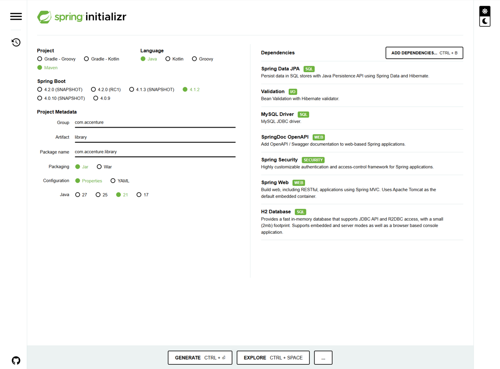

### Descarga del archivo .zip

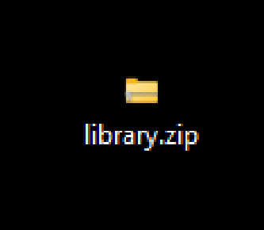

### Primera apertura en el IDE

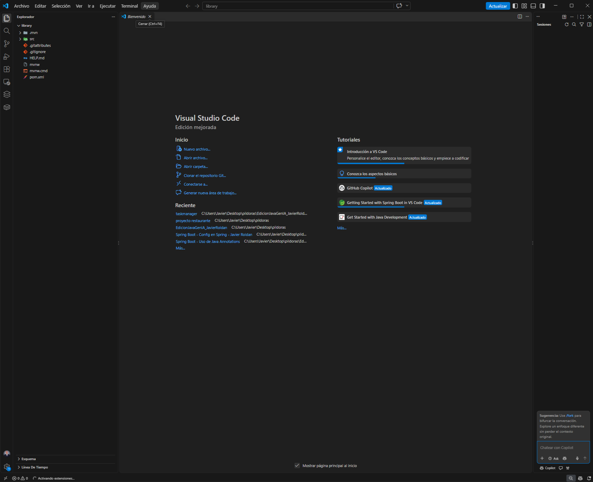

### Comprobación del esqueleto

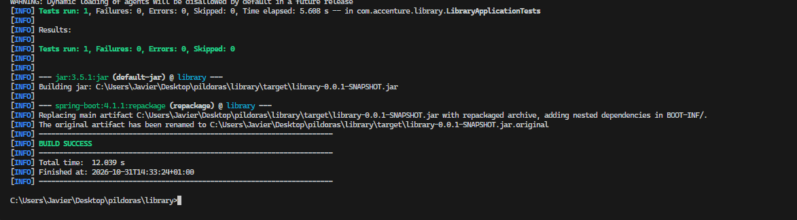

## 4. Arquitectura y organización del código

```
src/
├── main/
│   ├── java/
│   │   └── com/accenture/library/
│   │       ├── controller/             # Controladores REST
│   │       ├── dto/
│   │       │   ├── error/              # DTO de errores
│   │       │   ├── request/            # DTOs de entrada
│   │       │   ├── response/           # DTOs de salida
│   │       │   └── BookSearchCriteriaDTO.java
│   │       ├── enums/                  # Enumeraciones del dominio
│   │       ├── exception/              # Excepciones y manejo global
│   │       ├── mapper/                 # Conversión entre entidades y DTOs
│   │       ├── model/                  # Entidades JPA
│   │       ├── repository/
│   │       │   └── interfaces/         # Repositorios Spring Data JPA
│   │       ├── security/               # Configuración Spring Security y JWT
│   │       ├── service/
│   │       │   ├── impl/               # Implementaciones de servicios
│   │       │   └── interfaces/         # Interfaces de servicios
│   │       └── validation/             # Validadores personalizados
│   └── resources/
│       ├── application.properties
│       └── application-docker.properties
│
├── test/
│   └── java/
│       └── com/accenture/library/
│           ├── controller/
│           ├── mapper/
│           ├── security/
│           ├── service/
│           │   └── impl/
│           └── validation/
│
├── db/
│   └── init.sql
│
├── Dockerfile
└── pom.xml
```

### 4.1 Responsabilidades de cada capa
- Controller: recibe las peticiones HTTP, valida los datos de entrada, delega en los servicios y devuelve las respuestas mediante ResponseEntity. No contiene lógica de negocio.
- Service: implementa las reglas de negocio y coordina las operaciones entre repositorios y mappers.
- Repository: proporciona el acceso a MySQL mediante Spring Data JPA.
- Model: contiene las entidades persistentes del dominio.
- DTO: separa los datos recibidos y devueltos por la API de las entidades JPA.
- Mapper: realiza la conversión manual entre entidades y DTOs.
- Validation: contiene validadores específicos para reglas que no se resuelven únicamente con anotaciones estándar.
- Exception: centraliza el tratamiento de errores y el formato de las respuestas.
- Security: contiene la configuración de Spring Security, el filtro JWT, la autenticación y las constantes de seguridad.

---


## 5. Creación de la BBDD

### 5.1 Modelo de datos y base de datos
La aplicación utiliza MySQL 8.0 o superior. La base de datos se llama library y el esquema se crea mediante el script db/init.sql, situado en la raíz del proyecto, al mismo nivel que pom.xml.
### 5.2. Entidades y relaciones
El modelo contempla las siguientes entidades:
- Category: categoría a la que puede pertenecer un libro.
- Author: autor que puede estar relacionado con uno o varios libros.
- Book: libro, con ISBN, título, año de publicación, stock disponible y stock total.
- Loan: préstamo asociado a un libro, con fechas y estado.
Relaciones principales:
- Una categoría puede estar asociada a varios libros; un libro puede no tener categoría.
- La relación entre libros y autores es muchos a muchos.
- Un libro puede tener varios préstamos.
- Cada préstamo está asociado a un único libro.
El estado de los préstamos se representa mediante LoanStatus, con los estados utilizados por la aplicación: ACTIVE, OVERDUE y RETURNED.
### 5.3. Reglas de integridad y stock
- El ISBN de un libro es único.
- El nombre de una categoría es único.
- El stock disponible no puede superar el stock total.
- Al registrar un préstamo se comprueba que exista stock disponible y se descuenta una unidad.
- Al devolver un préstamo activo se incrementa el stock disponible y se actualiza el estado y la fecha real de devolución.
- No se permite devolver de nuevo un préstamo que ya esté devuelto.
### 5.4. Script de inicialización
El fichero db/init.sql:
1. Crea la base de datos library si todavía no existe.
2. Desactiva temporalmente las comprobaciones de claves foráneas.
3. Elimina las tablas existentes y las crea de nuevo.
4. Define claves primarias, claves foráneas y restricciones de unicidad.
5. Inserta datos de prueba coherentes.
El conjunto inicial contiene:
- 3 categorías, incluida una sin libros.
- 5 autores, incluido al menos uno sin libros.
- 10 libros, incluidos casos sin categoría, sin autores, sin stock disponible y sin préstamos.
- 5 préstamos, con préstamos activos futuros, activos vencidos y devueltos.
Las fechas relativas se calculan con CURDATE() para que los casos de préstamo vencido sigan siendo válidos con el paso del tiempo. La fecha futura se fija suficientemente lejos.
### 5.5. Configuración de conexión
La conexión del perfil habitual se configura exclusivamente en:

src/main/resources/application.properties

```
# Configuración de MySQL
spring.datasource.url=jdbc:mysql://localhost:3306/library
spring.datasource.username=root
spring.datasource.password=1234abcd

## Configuración JPA / Hibernate
spring.jpa.hibernate.ddl-auto=validate
spring.jpa.show-sql=true
spring.jpa.properties.hibernate.format_sql=true
```


## Se diseña la BBDD con los parámetros que se establecen en el enunciado del pdf

```
-- Active: 1780738611428@@127.0.0.1@3306@library

-- =========================================================
-- LIBRARY - Script de inicialización de la base de datos
-- MySQL 8.0+
-- =========================================================

CREATE DATABASE IF NOT EXISTS library
    CHARACTER SET utf8mb4
    COLLATE utf8mb4_0900_ai_ci;

USE library;

-- Desactivar temporalmente las comprobaciones de claves foráneas
-- para permitir reinicializar las tablas en cualquier orden.
SET FOREIGN_KEY_CHECKS = 0;

DROP TABLE IF EXISTS loan;
DROP TABLE IF EXISTS book_author;
DROP TABLE IF EXISTS book;
DROP TABLE IF EXISTS author;
DROP TABLE IF EXISTS category;

SET FOREIGN_KEY_CHECKS = 1;

-- =========================================================
-- TABLA: category
-- =========================================================

CREATE TABLE category (
    id BIGINT NOT NULL AUTO_INCREMENT,
    name VARCHAR(100) NOT NULL,
    description VARCHAR(500),
    CONSTRAINT pk_category PRIMARY KEY (id),
    CONSTRAINT uk_category_name UNIQUE (name)
) ENGINE = InnoDB
  DEFAULT CHARACTER SET = utf8mb4
  COLLATE = utf8mb4_0900_ai_ci;

-- =========================================================
-- TABLA: author
-- =========================================================

CREATE TABLE author (
    id BIGINT NOT NULL AUTO_INCREMENT,
    first_name VARCHAR(100) NOT NULL,
    last_name VARCHAR(100) NOT NULL,
    nationality VARCHAR(100),
    CONSTRAINT pk_author PRIMARY KEY (id)
) ENGINE = InnoDB
  DEFAULT CHARACTER SET = utf8mb4
  COLLATE = utf8mb4_0900_ai_ci;

-- =========================================================
-- TABLA: book
-- =========================================================

CREATE TABLE book (
    id BIGINT NOT NULL AUTO_INCREMENT,
    title VARCHAR(150) NOT NULL,
    isbn VARCHAR(20) NOT NULL,
    published_year INT,
    available_stock INT NOT NULL,
    total_stock INT NOT NULL,
    category_id BIGINT,
    CONSTRAINT pk_book PRIMARY KEY (id),
    CONSTRAINT uk_book_isbn UNIQUE (isbn),
    CONSTRAINT fk_book_category
        FOREIGN KEY (category_id)
        REFERENCES category (id)
) ENGINE = InnoDB
  DEFAULT CHARACTER SET = utf8mb4
  COLLATE = utf8mb4_0900_ai_ci;

-- =========================================================
-- TABLA INTERMEDIA: book_author
-- =========================================================

CREATE TABLE book_author (
    book_id BIGINT NOT NULL,
    author_id BIGINT NOT NULL,
    CONSTRAINT pk_book_author PRIMARY KEY (book_id, author_id),
    CONSTRAINT fk_book_author_book
        FOREIGN KEY (book_id)
        REFERENCES book (id),
    CONSTRAINT fk_book_author_author
        FOREIGN KEY (author_id)
        REFERENCES author (id)
) ENGINE = InnoDB
  DEFAULT CHARACTER SET = utf8mb4
  COLLATE = utf8mb4_0900_ai_ci;

-- =========================================================
-- TABLA: loan
-- =========================================================

CREATE TABLE loan (
    id BIGINT NOT NULL AUTO_INCREMENT,
    loan_date DATE NOT NULL,
    expected_return_date DATE NOT NULL,
    actual_return_date DATE,
    status VARCHAR(20) NOT NULL,
    book_id BIGINT NOT NULL,
    CONSTRAINT pk_loan PRIMARY KEY (id),
    CONSTRAINT fk_loan_book
        FOREIGN KEY (book_id)
        REFERENCES book (id)
) ENGINE = InnoDB
  DEFAULT CHARACTER SET = utf8mb4
  COLLATE = utf8mb4_0900_ai_ci;

-- =========================================================
-- DATOS INICIALES: CATEGORY (3)
-- =========================================================

INSERT INTO category (id, name, description) VALUES
(1, 'Novela', 'Narrativa de ficción'),
(2, 'Ciencia', 'Divulgación científica y técnica'),
(3, 'Historia', 'Obras históricas');

-- =========================================================
-- DATOS INICIALES: AUTHOR (5)
-- =========================================================

INSERT INTO author (id, first_name, last_name, nationality) VALUES
(1, 'Miguel', 'Cervantes', 'Española'),
(2, 'George', 'Orwell', 'Británica'),
(3, 'Isaac', 'Asimov', 'Estadounidense'),
(4, 'Mary', 'Shelley', 'Británica'),
(5, 'Ursula', 'Le Guin', 'Estadounidense');

-- =========================================================
-- DATOS INICIALES: BOOK (10)
-- =========================================================

INSERT INTO book
(id, title, isbn, published_year, available_stock, total_stock, category_id)
VALUES
(1, 'Don Quijote de la Mancha', '9788420412146', 1605, 2, 2, 1),
(2, '1984', '9780451524935', 1949, 1, 2, 1),
(3, 'Fundación', '9788497599244', 1951, 1, 2, 2),
(4, 'Frankenstein', '9780141439471', 1818, 2, 2, 1),
(5, 'Los desposeídos', '9780061054884', 1974, 1, 1, 2),
(6, 'El fin de la eternidad', '9780553292047', 1955, 0, 1, 2),
(7, 'Historia de dos ciudades', '9780141439600', 1859, 2, 2, 1),
(8, 'Libro sin categoría', '9780000000008', 2020, 1, 1, NULL),
(9, 'Libro sin autores', '9780000000009', 2021, 1, 1, 1),
(10, 'Libro sin préstamos', '9780000000010', 2022, 1, 1, 2);

-- =========================================================
-- RELACIÓN BOOK_AUTHOR
-- =========================================================

INSERT INTO book_author (book_id, author_id) VALUES
(1, 1),
(2, 2),
(3, 3),
(5, 5),
(6, 3),
(7, 1),
(7, 2),
(8, 5);

-- =========================================================
-- DATOS INICIALES: LOAN (5)
-- =========================================================

INSERT INTO loan
(id, loan_date, expected_return_date, actual_return_date, status, book_id)
VALUES
(1, DATE_SUB(CURDATE(), INTERVAL 5 DAY),
    '2099-12-31', NULL, 'ACTIVE', 2),

(2, DATE_SUB(CURDATE(), INTERVAL 30 DAY),
    DATE_SUB(CURDATE(), INTERVAL 15 DAY), NULL, 'ACTIVE', 3),

(3, DATE_SUB(CURDATE(), INTERVAL 20 DAY),
    DATE_SUB(CURDATE(), INTERVAL 10 DAY),
    DATE_SUB(CURDATE(), INTERVAL 12 DAY), 'RETURNED', 1),

(4, DATE_SUB(CURDATE(), INTERVAL 8 DAY),
    DATE_SUB(CURDATE(), INTERVAL 2 DAY),
    DATE_SUB(CURDATE(), INTERVAL 3 DAY), 'RETURNED', 4),

(5, DATE_SUB(CURDATE(), INTERVAL 3 DAY),
    '2099-12-31', NULL, 'ACTIVE', 6);

```

## 6. Comprobación de la creación de la BBDD desde la terminal

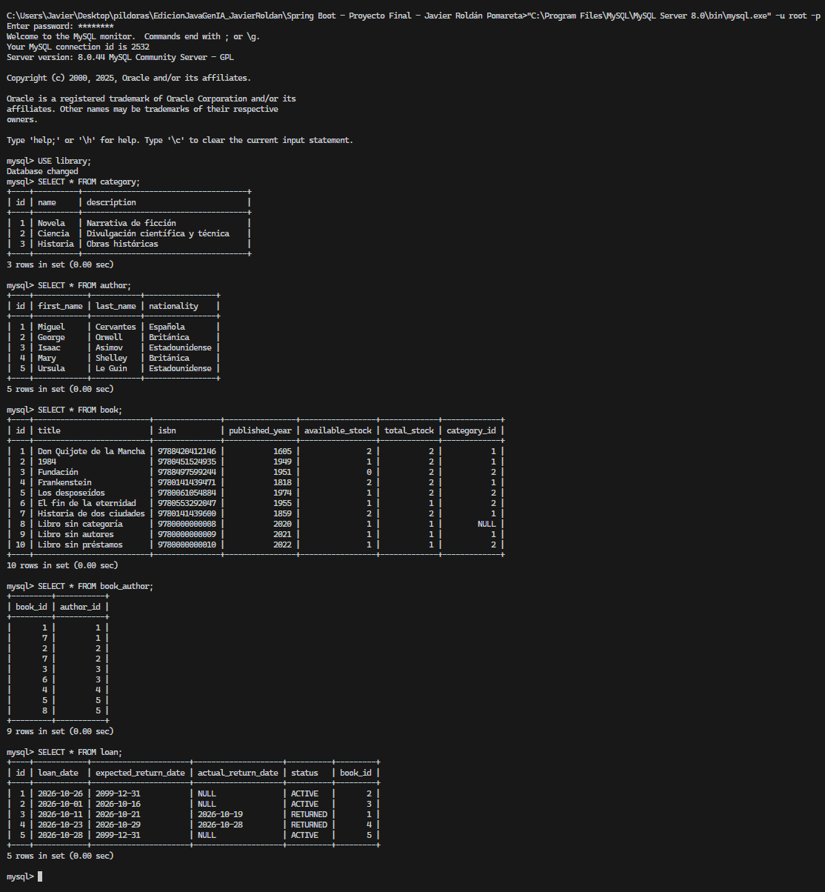

## 6.1 Requisitos previos
Antes de arrancar el proyecto es necesario disponer de:
Herramienta	Versión mínima
JDK	Java 21
Maven	3.9+
MySQL Server	8.0+
Git	Versión compatible con el sistema


También se recomienda disponer de MySQL Workbench o una herramienta equivalente para consultar la base de datos.

Comprobar las versiones desde una terminal:

```
java -version
mvn -version
mysql --version
```

## 7. Instalación y ejecución desde cero
### 7.1. Obtener el proyecto
Clonar el repositorio:

```
git clone https://github.com/jroldanpomareta/EdicionJavaGenIA_JavierRoldan.git
```

### 7.2. Crear la base de datos
Iniciar el servicio MySQL y ejecutar el script desde la raíz del proyecto:

```
mysql -u root -p < db/init.sql
```

Introducir la contraseña de MySQL cuando se solicite.

También se puede abrir db/init.sql desde MySQL Workbench y ejecutar el script completo.

El script reinicializa las tablas y los datos de prueba. No lo ejecutes sobre una base de datos que contenga información que quieras conservar.
### 7.3. Configurar las credenciales de MySQL
Abrir:

src/main/resources/application.properties

Configurar las propiedades:

```
spring.datasource.url=jdbc:mysql://localhost:3306/library
spring.datasource.username=root
spring.datasource.password=TU_PASSWORD_MYSQL
```

La contraseña indicada es la de tu instalación local de MySQL. No es la contraseña de los usuarios de la API.
### 7.4. Configurar la clave JWT
La propiedad app.jwt.secret utiliza la variable de entorno JWT_SECRET. La aplicación espera una clave codificada en Base64 que, una vez decodificada, tenga longitud suficiente para HS256 (al menos 32 bytes).

En PowerShell se puede generar una clave aleatoria así:

```
$bytes = New-Object byte[] 32
[System.Security.Cryptography.RandomNumberGenerator]::Fill($bytes)
$env:JWT_SECRET = [Convert]::ToBase64String($bytes)
```

Esta variable debe estar definida en la misma sesión de terminal desde la que se arranque la aplicación. Para un entorno persistente, configúrala de forma segura en el sistema y no la guardes en Git.

Las credenciales de los usuarios de prueba se configuran mediante propiedades. Por defecto, la aplicación utiliza los valores del enunciado:

```
app.security.admin.username=${ADMIN_USERNAME:admin}
app.security.admin.password=${ADMIN_PASSWORD:admin123}
app.security.user.username=${USER_USERNAME:user}
app.security.user.password=${USER_PASSWORD:user123}
```

Se pueden sobrescribir mediante las variables de entorno indicadas.
### 7.5. Compilar y ejecutar los tests
Desde la raíz del proyecto:

```
mvn clean test
```

Para empaquetar la aplicación:

```
mvn clean package
```

Para generar también el informe JaCoCo:

````
mvn clean verify
```

El informe HTML de JaCoCo se genera en:

```
target/site/jacoco/index.html
````

### 7.6. Arrancar la aplicación
Desde la raíz del proyecto:

```
mvn spring-boot:run
```

También se puede ejecutar el JAR generado:

```
java -jar target/library-0.0.1-SNAPSHOT.jar
```

La aplicación utiliza el puerto 8080.

---

## 8. Autenticación y seguridad JWT
La API utiliza Spring Security con sesiones deshabilitadas y autenticación mediante JWT.
# 8.1. Usuarios disponibles

| Usuario | Contraseña | Rol |
|---|---|---|
| `admin` | `admin123` | `ADMIN` |
| `user` | `user123` | `USER` |

Son credenciales de demostración exigidas por el enunciado. No deben utilizarse en un entorno real.

## 8.2. Obtener un token
La autenticación se realiza mediante el endpoint público:

POST /auth/login

Body de ejemplo:

```
{
  "username": "admin",
  "password": "admin123"
}
```

La respuesta correcta devuelve HTTP 200 OK y un objeto con el token:

```
{
  "token": "eyJ..."
}
```

### Evidencia de autenticación JWT

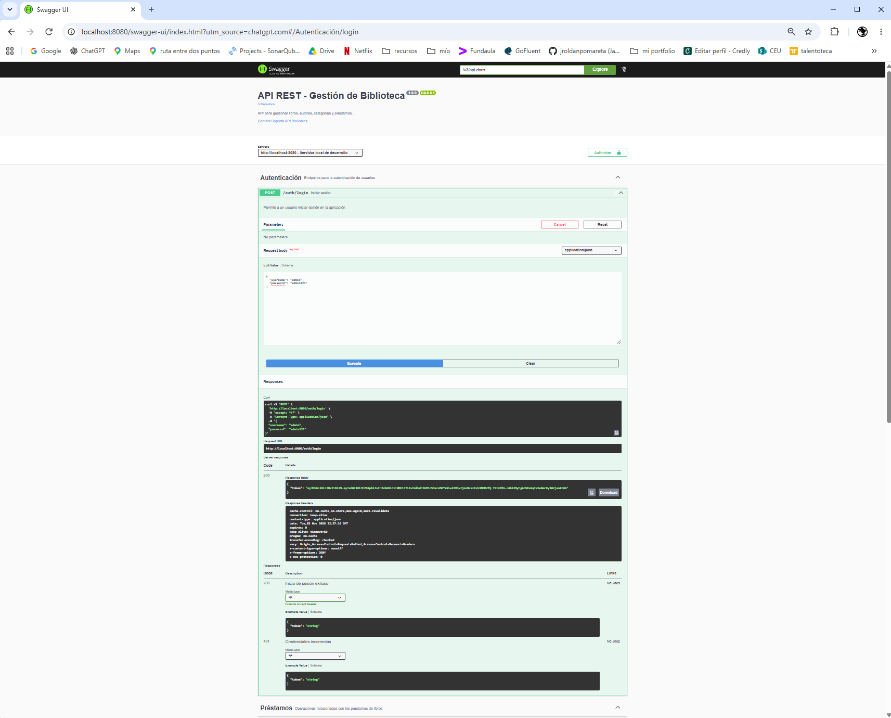

## 8.3. Enviar el token
Para acceder a los endpoints protegidos, incluir la cabecera:

```
Authorization: Bearer <token>
```

### Evidencia de autorización Bearer JWT

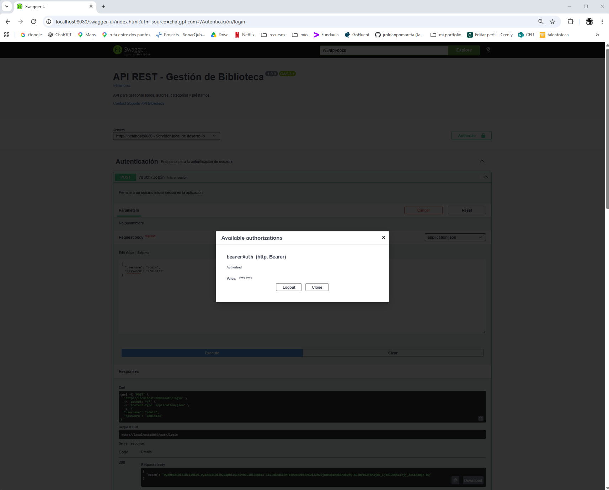

En Swagger UI se puede utilizar el botón Authorize para introducir el token obtenido en el login.
8.4. Permisos
- ADMIN: puede utilizar todos los endpoints, incluidos los DELETE permitidos.
- USER: puede utilizar los endpoints protegidos excepto los DELETE de libros, autores y categorías.
- Las rutas de login y documentación Swagger/OpenAPI son públicas.
- Los endpoints restantes requieren un JWT válido.
Respuestas de seguridad principales:
- 401 Unauthorized: no se ha enviado un token válido o ha caducado.
- 403 Forbidden: el usuario está autenticado, pero no tiene permisos para la operación.
El token se firma mediante HS256 e incluye el usuario, el rol, la fecha de emisión y la fecha de expiración. Su duración configurada es de 24 horas.
## 9. Endpoints de la API
Todos los endpoints de gestión cuelgan de /api/v1. Salvo el login y las rutas de documentación, requieren autenticación.
### 9.1. Autenticación

| Método | Endpoint | Descripción | Respuestas principales |
|---|---|---|---|
| POST | `/auth/login` | Autenticar usuario y obtener JWT | 200, 400, 401 |

##9.2. Libros

| Método | Endpoint | Descripción | Respuestas principales |
|---|---|---|---|
| GET | `/api/v1/books` | Listar libros con paginación y filtros | 200, 400 |
| GET | `/api/v1/books/{id}` | Obtener un libro por ID | 200, 404 |
| POST | `/api/v1/books` | Crear un libro | 201, 400, 409 |
| PUT | `/api/v1/books/{id}` | Actualizar un libro | 200, 400, 404, 409 |
| DELETE | `/api/v1/books/{id}` | Eliminar un libro | 204, 404, 409 |

### 9.3. Autores

| Método | Endpoint | Descripción | Respuestas principales |
|---|---|---|---|
| GET | `/api/v1/authors` | Listar autores | 200 |
| GET | `/api/v1/authors/{id}` | Obtener un autor por ID | 200, 404 |
| POST | `/api/v1/authors` | Crear un autor | 201, 400 |
| PUT | `/api/v1/authors/{id}` | Actualizar un autor | 200, 400, 404 |
| DELETE | `/api/v1/authors/{id}` | Eliminar un autor | 204, 404, 409 |

### 9.4. Categorías

| Método | Endpoint | Descripción | Respuestas principales |
|---|---|---|---|
| GET | `/api/v1/categories` | Listar categorías | 200 |
| POST | `/api/v1/categories` | Crear una categoría | 201, 400, 409 |
| DELETE | `/api/v1/categories/{id}` | Eliminar una categoría | 204, 404, 409 |

### 9.5. Préstamos

| Método | Endpoint | Descripción | Respuestas principales |
|---|---|---|---|
| GET | `/api/v1/loans` | Listar préstamos | 200 |
| GET | `/api/v1/loans/{id}` | Obtener un préstamo por ID | 200, 404 |
| POST | `/api/v1/loans` | Crear un préstamo | 201, 400, 409 |
| PUT | `/api/v1/loans/{id}/return` | Registrar la devolución de un préstamo | 200, 404, 409 |

Los endpoints DELETE devuelven HTTP 204 No Content sin cuerpo. No existe un endpoint DELETE para préstamos.
### 9.6. Paginación, ordenación y filtros de libros
El listado de libros admite los siguientes parámetros:

| Parámetro | Descripción |
|---|---|
| `page` | Número de página. Por defecto, `0`. |
| `size` | Número de elementos por página. Por defecto, `20`. |
| `sort` | Criterio de ordenación. Por defecto, `title,asc`. |
| `title` | Filtra por título. |
| `author` | Filtra por autor. |
| `isbn` | Filtra por ISBN. |
| `categoryId` | Filtra por identificador de categoría. |
| `authorId` | Filtra por identificador de autor. |
| `available` | `true` para libros con stock disponible; `false` para libros sin stock. |

Los filtros se pueden combinar. Si no hay resultados, la API devuelve una página vacía con HTTP 200 OK.

Ejemplo:

```
GET /api/v1/books?page=0&size=10&sort=title,asc&available=true
```

## 10. Documentación interactiva con Swagger
Con la aplicación arrancada, acceder a:

Swagger UI – http://localhost:8080/swagger-ui.html

La documentación agrupa los endpoints por controladores y permite consultar los parámetros, cuerpos de petición, DTOs y respuestas documentadas.

### Vista general de Swagger UI

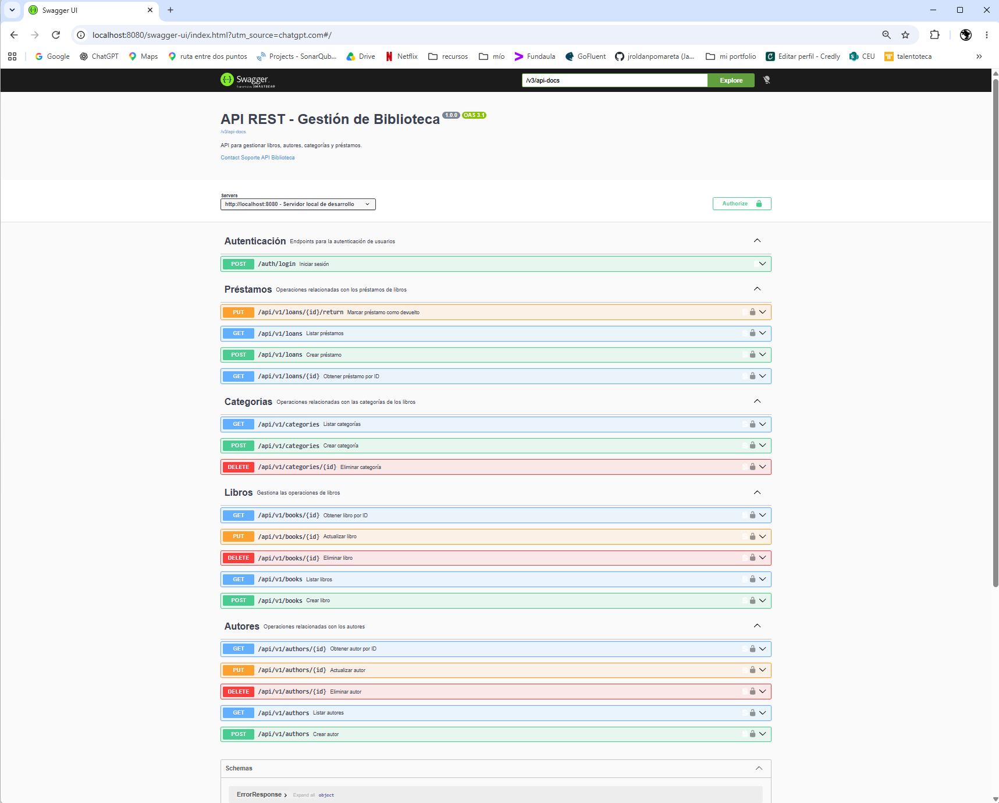

Para probar endpoints protegidos:
1. Ejecutar POST /auth/login.
2. Copiar el valor de token de la respuesta.
3. Pulsar Authorize en Swagger UI.
4. Introducir el token en el esquema Bearer JWT.
5. Ejecutar los endpoints autorizados para el rol utilizado.

## 11. Validación y gestión de errores
Los DTOs de entrada utilizan Jakarta Validation para comprobar los datos recibidos. También se han implementado validadores personalizados para reglas de negocio que requieren comprobaciones adicionales, como la coherencia entre stock disponible y stock total y las fechas de los préstamos.

El manejo de excepciones se centraliza mediante GlobalExceptionHandler, que devuelve respuestas de error estructuradas mediante ErrorResponse.

Entre los códigos gestionados se encuentran:

| Código | Significado |
|---|---|
| 400 | Datos de entrada o parámetros inválidos |
| 401 | Usuario no autenticado o token no válido |
| 403 | Usuario autenticado sin permisos |
| 404 | Recurso no encontrado |
| 405 | Método HTTP no permitido para la ruta |
| 409 | Conflicto con el estado o las reglas del recurso |
| 500 | Error interno no controlado |

## 12. Pruebas automatizadas
Las pruebas se implementan con JUnit 5, Mockito, Spring Boot Test, MockMvc y Spring Security Test. No requieren una instancia de MySQL ni servicios externos.

El enunciado exige un mínimo de 12 pruebas y no exige alcanzar un porcentaje global de cobertura.
### 12.1. Tipos de pruebas
- Service: pruebas unitarias con @ExtendWith(MockitoExtension.class), @Mock e @InjectMocks, sin levantar el contexto de Spring.
- Controller: pruebas MVC con @WebMvcTest, MockMvc y dependencias simuladas mediante @MockitoBean.
- Mapper: comprobación de la conversión de un préstamo activo vencido a estado OVERDUE.
- Validator: comprobación de que el stock disponible no puede superar el stock total.
- Seguridad: comprobación de la generación del JWT y de la denegación de operaciones DELETE a un usuario con rol USER.
### 12.2. Casos funcionales cubiertos
El proyecto incluye 12 pruebas automatizadas, distribuidas en las siguientes categorías:
**Pruebas de Service (5)**
1. `crearPrestamo_shouldCrearPrestamoYReducirStock_whenHayStockDisponible`: comprueba que se crea un préstamo correctamente y se reduce el stock del libro.
2. `crearPrestamo_shouldLanzarConflictException_whenNoHayStockDisponible`: comprueba que se produce un conflicto al intentar prestar un libro sin stock.
3. `devolverLibro_shouldCambiarEstadoADevuelto_whenPrestamoActivo`: comprueba que el estado del préstamo cambia a `RETURNED`.
4. `devolverLibro_shouldIncrementarStock_whenPrestamoActivo`: comprueba que se incrementa el stock al devolver un préstamo activo.
5. `devolverLibro_shouldLanzarConflictException_whenPrestamoYaDevuelto`: comprueba que se produce un conflicto al intentar devolver un préstamo que ya está devuelto.
**Pruebas de Controller (3)**
6. `obtenerLibroPorId_shouldReturnNotFound_whenBookDoesNotExist`: comprueba que se devuelve HTTP 404 al consultar un libro inexistente.
7. `crearLibro_shouldReturnBadRequest_whenRequestIsInvalid`: comprueba que se devuelve HTTP 400 al enviar una solicitud inválida.
8. `crearLibro_shouldReturnCreated_whenRequestIsValid`: comprueba que se devuelve HTTP 201 al crear un libro con datos válidos.
**Prueba de Mapper (1)**
9. `toResponseDTO_shouldReturnOverdue_whenExpectedReturnDateIsBeforeToday`: comprueba que un préstamo `ACTIVE` cuya fecha prevista de devolución ha vencido se transforma en un DTO con estado `OVERDUE`.
**Prueba de validación (1)**
10. `testAvailableStockGreaterThanTotalStock`: comprueba que la validación falla cuando el stock disponible supera el stock total.
**Pruebas de seguridad (2)**
11. `generarToken_shouldContainUsernameAndRole_whenCredentialsAreProvided`: comprueba que el JWT generado contiene el nombre de usuario y el rol.
12. `eliminarLibro_shouldReturnForbidden_whenUserHasRoleUser`: comprueba que un usuario con rol `USER` recibe HTTP 403 al intentar eliminar un libro, utilizando la configuración de seguridad real.

Todos los tests se ejecutan mediante Maven y no requieren una conexión activa a MySQL.
### 12.3. Ejecutar las pruebas

```
mvn clean test
```

### Evidencia de ejecución de pruebas

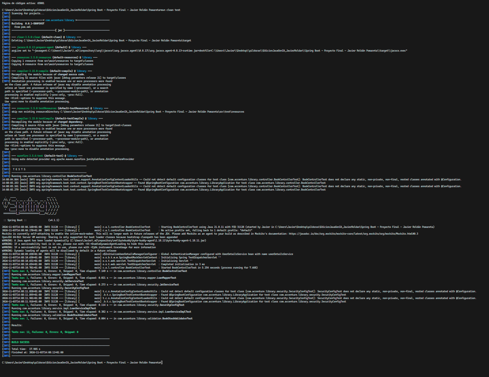

Para generar el informe de cobertura:

```
mvn clean verify
```

El informe HTML de JaCoCo estará disponible en target/site/jacoco/index.html.

### Informe de cobertura JaCoCo

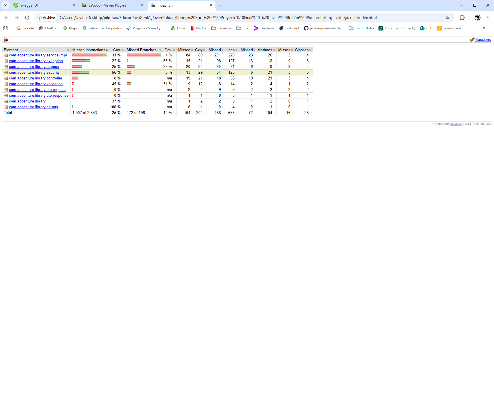

## 13. Decisiones técnicas y buenas prácticas
- Se utiliza arquitectura por capas para separar presentación, negocio y persistencia.
- Los controladores delegan la lógica de negocio en interfaces de servicio.
- Se utilizan DTOs para no exponer directamente las entidades JPA.
- La conversión entre entidades y DTOs se realiza en clases Mapper independientes.
- Se utiliza ResponseEntity para controlar los códigos HTTP devueltos.
- La validación se realiza en los DTOs y mediante validadores personalizados cuando la regla lo requiere.
- Las excepciones se gestionan centralizadamente para mantener una estructura de error consistente.
- La persistencia utiliza Spring Data JPA y Hibernate.
- La estrategia ddl-auto=validate evita que Hibernate modifique automáticamente el esquema de MySQL.
- La seguridad utiliza sesiones sin estado y JWT con expiración de 24 horas.
- Las contraseñas de los usuarios en memoria se codifican mediante BCrypt.
- Las constantes relacionadas con roles y el prefijo Bearer se centralizan en SecurityConstants.
- Se documentan las clases y métodos de src/main mediante Javadoc.
- Se evita el uso de lambdas y Streams fuera de las excepciones expresamente permitidas por el enunciado.
- Se utiliza JaCoCo para disponer de información de cobertura y SonarQube Server como herramienta complementaria de análisis estático.
## 14. Extras y cambios respecto al enunciado
Además de los requisitos principales, el proyecto incorpora:
- Lombok: utilizado en las clases donde permite reducir código repetitivo, manteniendo legibilidad. Los métodos generados por Lombok no requieren Javadoc según el enunciado.
- JaCoCo: añadido para generar informes de cobertura de pruebas.
- SonarQube Server: utilizado para analizar mantenibilidad, fiabilidad, seguridad y duplicaciones del código.
- DTO de criterios de búsqueda: BookSearchCriteriaDTO agrupa los parámetros de paginación y filtrado de libros para evitar una firma de servicio excesivamente extensa.
- Constantes de seguridad: SecurityConstants centraliza los prefijos y roles utilizados por los componentes de seguridad.
Cualquier funcionalidad opcional adicional se documentará aquí una vez implementada y verificada.
## 15. Análisis estático con SonarQube
El proyecto se ha analizado mediante SonarQube Server en el entorno local.

La herramienta permite revisar:
- Bugs y posibles errores.
- Vulnerabilidades y puntos de seguridad.
- Mantenibilidad y code smells.
- Bloques de código duplicados.
- Cobertura importada desde JaCoCo.
La cobertura se utiliza como información de análisis. El enunciado del proyecto no establece un porcentaje mínimo global de cobertura, sino un conjunto concreto de pruebas obligatorias.

### Análisis métricas SonarQube

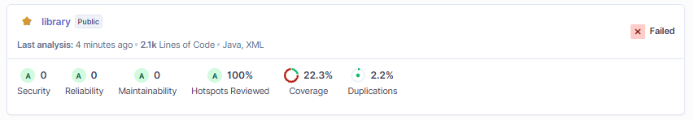
### Panel general de SonarQube

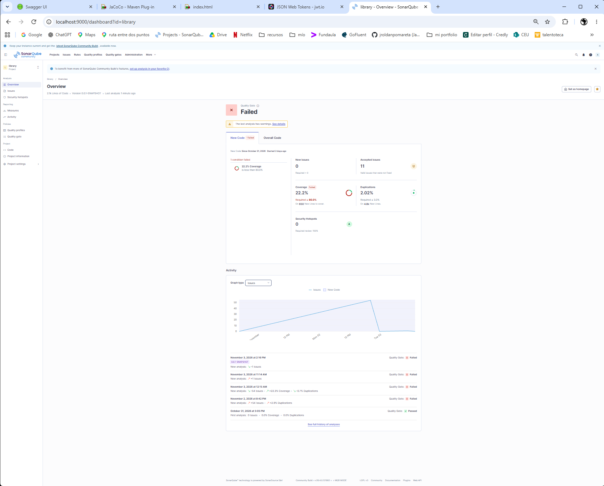

## 16. Docker (requisito opcional)

El proyecto incorpora una configuración Docker para facilitar la construcción y ejecución de la API REST en un contenedor independiente.

La implementación utiliza una construcción multi-stage, separando la fase de compilación de Maven de la imagen final de ejecución. De esta forma, la imagen definitiva contiene únicamente los elementos necesarios para ejecutar la aplicación.

### 16.1. Arquitectura Docker

La solución contempla los siguientes elementos:

- **Dockerfile:** situado en la raíz del proyecto.
- **Etapa de construcción:** utiliza Maven 3.9 y Eclipse Temurin 21 para compilar y empaquetar la aplicación.
- **Etapa de ejecución:** utiliza Eclipse Temurin 21 JRE sobre Alpine Linux.
- **Perfil Spring `docker`:** permite utilizar una configuración específica para el entorno de contenedor.
- **Base de datos H2:** utilizada en memoria para evitar depender de una instalación externa de MySQL.
- **Hibernate:** utiliza `create-drop` en el perfil Docker para crear y eliminar el esquema durante el ciclo de vida del contenedor.

La configuración habitual de MySQL permanece independiente y no se modifica al ejecutar la aplicación en su perfil normal.

### 16.2. Construcción de la imagen

Desde la raíz del proyecto, donde se encuentra el Dockerfile, ejecutar:

```
docker build -t library:1.0 .
```

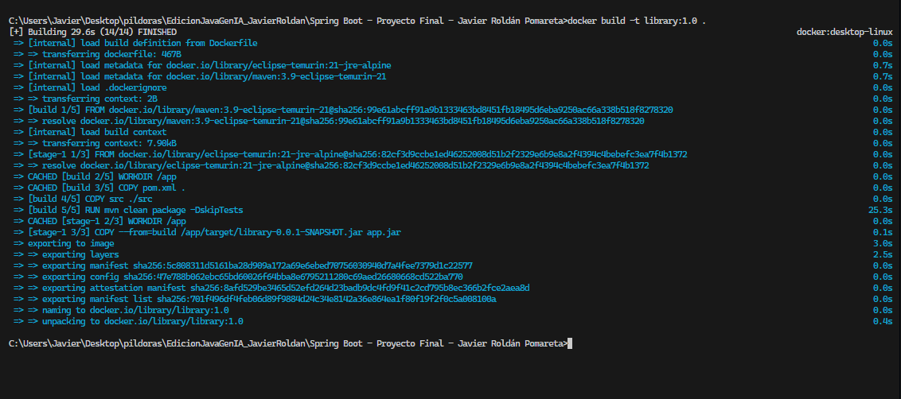

## 16.3 Ejecución del contenedor:

Ejecutar el siguiente comando:

```
docker run -d --name library-container -p 8080:8080 library:1.0
```

Para comprobar que el contenedor está en ejecución:

```
docker ps
```

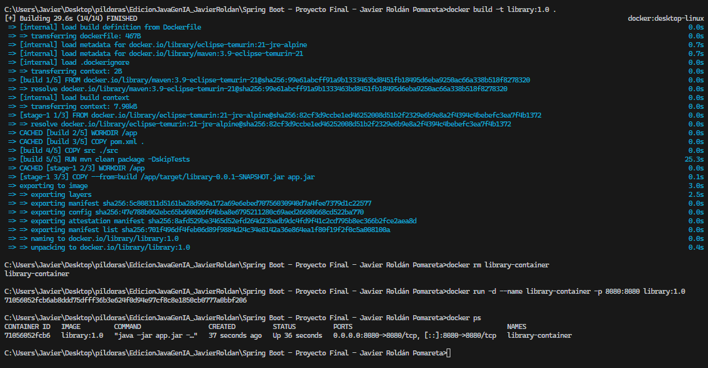

## 17. Capturas de pantalla y evidencias
Las imágenes se guardan en la carpeta capturas/ de la raíz del proyecto. Se recomienda mantener nombres descriptivos y numeración correlativa.

| Nombre de archivo | Evidencia que debe mostrar |
|---|---|
| `Captura-01-Javier-Roldan-Pomareta.png` | Fotografía del autor |
| `Captura-02-configuracion-spring-initializr.png` | Configuración de Spring Initializr |
| `Captura-03-descarga-del-zip.png` | Descarga del ZIP inicial |
| `Captura-04-Primera-apertura-en-el-IDE.png` | Proyecto abierto en Visual Studio Code (ya incluida) |
| `Captura-05-Comprobacion-del-esqueleto.png` | Estructura inicial del proyecto (ya incluida) |
| `Captura-06-Comprobacion-creacion-BBDD.png` | Base de datos y tablas creadas (ya incluida) |
| `Captura-07-Swagger-UI.png` | Swagger UI con los controladores y endpoints |
| `Captura-08-Autenticacion-JWT.png` | Respuesta correcta de `POST /auth/login` |
| `Captura-09-Swagger-Authorize.png` | Token Bearer introducido en Swagger |
| `Captura-10-Tests-Build-Success.png` | Terminal con `mvn clean test` y `BUILD SUCCESS` |
| `Captura-11-JaCoCo.png` | Informe HTML de JaCoCo |
| `Captura-12-SonarQubea.png` | Análisis métricas SonarQube |
| `Captura-12-SonarQubeb.png` | Panel del proyecto en SonarQube |
| `Captura-13-Docker-Build.png` | Construcción correcta de la imagen Docker |
| `Captura-14-Docker-Container.png` | Contenedor ejecutándose y API accesible |

## 18. Estado de cumplimiento
Esta tabla se actualizará al terminar la implementación y la revisión final del proyecto.

| Bloque | Estado |
|---|---|
| Arquitectura por capas | Implementada en el código entregado para revisión |
| Endpoints REST | Implementados |
| Persistencia MySQL y `db/init.sql` | Implementada |
| Validación y gestión global de errores | Implementadas |
| Seguridad JWT y roles | Implementada |
| Documentación OpenAPI | Implementada |
| Tests exigidos | Ejecutados correctamente con `mvn clean test` |
| README | Implementado |
| Docker opcional | Implementado |
| Revisión final del PDF | Implementado |

## 19. Licencia y uso
Proyecto desarrollado con fines formativos como ejercicio de aplicación de conocimientos de desarrollo backend con Java y Spring Boot.